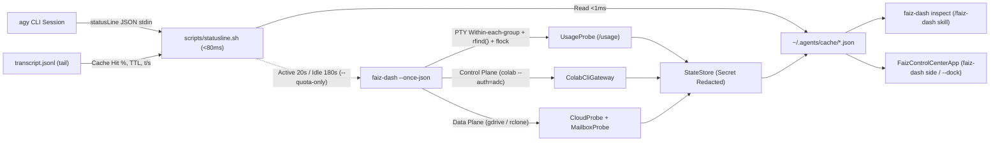

# Faiz Control Center (`faiz-dash`)

[](LICENSE)
[](pyproject.toml)
[](https://textual.textualize.io/)

**Ultra-fast (`<80ms`) TrueColor `statusLine` for [Antigravity CLI](https://antigravity.google) (`agy`) & Grok CLI (`grok`), exact 2-decimal `/usage` quota sync, zero-clutter in-session diagnostic bubbles (`/faiz-dash`), and an on-demand Textual TUI Control Center.**

> Forked from [Jamie-z-Jianmin/faiz-control-center](https://github.com/Jamie-z-Jianmin/faiz-control-center) and tailored for Antigravity (`agy`) + Grok (`grok`) workflows — replaces the 3P Claude quota capsule in `agy` with a live **Gemini Quota Reset & Burn-Pace Forecast** (`↻ Reset 5h·Wk` + `~Xm` run-out forecast) capsule and ships a matching 2×3 glass capsule renderer (`scripts/grok-statusline.sh`) for Grok CLI sharing `~/.agents/statusline_config.json`.

English | [简体中文](README.zh-CN.md)


---

## Highlights

- **Zero-Latency Native `stdin` Quota Fast-Path + PTY `/usage` Fallback (`GEMINI MODELS` + `CLAUDE AND GPT MODELS`)**: Directly consumes native `agy` `stdin.quota` (`gemini-5h`, `gemini-weekly`, `3p-5h`, `3p-weekly`, `reset_in_seconds`) with zero PTY overhead when present (extending PTY background cooldown to `600s` for global burn/account metadata), and seamlessly falls back to the `flock`-guarded isolated PTY `/usage` probe (`20s` active / `180s` idle) when absent. Includes `stdin.terminal_width` priority over stale `$COLUMNS`, `reset_at_epoch + 60s` expiry auto-reset, and `weekly == 0` coupling so exhausted pools never misreport `100%` 5h capacity.
- **Sub-80ms Pure Bash + `jq` StatusLine**: Never blocks prompt rendering. Features a unified **deep slate-blue** palette with a responsive matrix: Col-4 stacked `Gemini + Claude` **`2×4` full-width water-fill** across wide/ultrawide (`>=155` cols, uncapped) and split panes (`86–154` cols, preserving exact 2-decimal precision, `Speed` label, and symmetrical `Cache --` / `Speed --` new-session placeholders), tight **5-line `4×2` slate-blue `[ ... ]` outline** (`46–85` cols), plus `Apple_Terminal` 16-color fallback and zero-noise cloud hiding.
- **Prompt Cache Hit & Live Token Speed (`t/s`)**: Reads only the trailing tail of the active session `transcript.jsonl` (with `stdin.context_window.current_usage` fallback before transcript flush) to surface Cache Hit %, 3m/4m TTL cooldown alerts, and real-time output generation speed (`t/s`).
- **Zero-Clutter On-Demand Inspection & Quota Pace Forecast**:
  - **In-chat Diagnostic Bubble (`/faiz-dash` / `faiz-dash inspect`)**: Outputs a clean Markdown summary of all quota buckets, reset countdowns, **burn Pace & Run-Out Forecast** (`Pace / Forecast` vs elapsed 5h/weekly window timeline), 24h per-model token burn, cloud/drive backoff & `colab_source` / `colab_gpu` / `drive_backend` telemetry, mailbox items, and read-only APM telemetry without occupying terminal width.
  - **Environment Health Check (`faiz-dash doctor`)**: Verifies Python runtime/packages, `bash`/`jq`, terminal TrueColor, Nerd Font capsule glyphs (` ● `), `statusline.sh` permissions, `agy settings.json` wiring, and snapshot cache ages (supports `--markdown` privacy-masked output & `--json`).
  - **On-Demand Rex Sidebar (`faiz-dash side`)**: Toggles a 28% vertical Textual sidebar in Rex (`--focus=false`) on demand (`q` or `faiz-dash side` to dismiss), with compact `Pace:` indicators inside `QuotaPanel`. Defaults to no permanent dock (`faiz-dash off`).
- **Bilingual Settings Studio (`faiz-dash config`)**: Interactive `en`/`zh` Textual config editor with 5 visual styles (`capsule`, `powerline`, `pill`, `ghost`, `minimal`), 5 themes (`google`, `nord`, `tokyo_night`, `catppuccin`, `custom`), **per-capsule color overrides (`capsule_colors`)** (`blue`, `green`, `yellow`, `red`, `slate`, `muted`, `auto`, with `argon` falling back cleanly to `claude`), row uniform palettes, `ring`/`bar` indicators, quota precision (`exact` 2dp / `1dp` / `int`), Rex split ratios, and live preview with **isolated scenario (`p`: Live / Normal / Limits / New) & width (`w`: Auto / 58c / 91c / 168c) cycling**.
- **Dual-Plane Cloud & Worker Swarm Extension**: Decouples the `google-colab-cli` (`colab --auth=adc`) Control Plane (active sessions, GPU hardware, compute-unit balance) from the Drive Data Plane, backed by an auto-selected `gdrive` CLI + `rclone` Drive gateway (`FAIZ_DRIVE_BACKEND=auto|gdrive|rclone`), GCE Spot instance monitoring, persistent exponential rate-limit backoff, and async mailbox job verification.

---

## TUI Control Center & Settings Studio


---

## Architecture



---

## Quick Start (30 Seconds)

### Prerequisites
- **macOS or Linux** with Python **3.12+**, `bash`, and `jq`
- **Antigravity CLI** (`agy` on `PATH`)
- Optional: **Rex Terminal** (`rex` on `PATH`) for `faiz-dash side` / `dock` split panes; **`colab` CLI (`google-colab-cli`), `gdrive` CLI, `rclone`, or `gcloud`** only if using Colab/GCE/Drive cloud monitoring

### Install

#### One-line installer (macOS & Linux)

```bash
curl -fsSL https://raw.githubusercontent.com/vabruce/faiz-control-center/main/docs/site/install.sh | bash
# Optional: automatically wire statusLine into ~/.gemini/antigravity-cli/settings.json
curl -fsSL https://raw.githubusercontent.com/vabruce/faiz-control-center/main/docs/site/install.sh | FAIZ_WIRE_SETTINGS=1 bash
```

#### Manual / Developer install

```bash
git clone https://github.com/vabruce/faiz-control-center.git
cd faiz-control-center

# 1. Install Python package & Textual UI (use a virtualenv or pipx)
python3 -m pip install -e .

# 2. Link statusline, CLI wrapper, Rex hook, and /faiz-dash skill (add --wire-settings to auto-configure settings.json)
./install.sh --link --wire-settings   # use --copy for standalone copy without symlinks
```

Ensure `~/.local/bin` is in your `PATH`. `--wire-settings` safely backs up and merges `~/.gemini/antigravity-cli/settings.json` (preserving `stack_with_default`/`padding`, refusing corrupted JSON); or configure manually:

```json
{
  "statusLine": {
    "type": "command",
    "command": "~/.agents/scripts/statusline.sh"
  }
}
```

For **Grok CLI (`grok`)**, `install.sh` also links `~/.agents/scripts/grok-statusline.sh` (or invoke via `~/.grok/statusline.sh`):

```toml
[ui.status_line]
type = "command"
command = "~/.grok/statusline.sh"
padding = 0
refresh_interval = 60
```

### Verify

```bash
faiz-dash doctor          # Check Python, bash/jq, TrueColor, Nerd Fonts, settings.json & caches
faiz-dash inspect         # Non-interactive Markdown report (with Pace / Forecast) from cache
faiz-dash inspect --live  # Run fresh probes and print Markdown report
faiz-dash config          # Open interactive settings TUI with scenario (p) & width (w) live preview
```

---

## CLI & Hotkey Reference

| Command | Description |
| :--- | :--- |
| `faiz-dash inspect [--live] [--json]` | Print sanitized Markdown (or JSON) snapshot of quotas, **Pace / Forecast**, burn, cloud/backoff, mailbox, and telemetry |
| `faiz-dash doctor [--markdown] [--json]` | Run 9-point environment & installation health check (TrueColor, Nerd Font glyphs, `settings.json`, caches) |
| `faiz-dash side` | Toggle on-demand right-split Textual sidebar inside Rex (`--focus=false`), or print native Terminal hint |
| `faiz-dash dock` | Toggle on-demand bottom 3-column Dock inside Rex |
| `faiz-dash config` | Launch interactive settings TUI (`p` cycle preview scenario, `w` cycle preview width; also supports CLI flags: `--style`, `--indicator`, `--density`, `--secondary`, `--theme`, `--lang`, `--quota-precision`, `--row-colors`, `--capsule-color <id>=<color>`, `--side-ratio`, `--auto-dock on\|off`, `--show`, `--reset`) |
| `faiz-dash off` / `on` / `status` | Disable/enable startup auto-dock (`~/.agents/cache/dash_disabled`) and inspect cache ages |
| `faiz-dash --once-json [--quota-only] [--no-pty]` | Run one-shot probe collection and emit combined JSON |
| `faiz-dash --preset 1 \| 2` | Open full-terminal TUI directly in horizontal Dock (`1`) or vertical Sidebar (`2`) |

### In-TUI Keybindings (`faiz-dash` / `faiz-dash side`)

- `Tab` / `Shift+Tab`: Focus next / previous panel
- `1` / `2`: Switch Horizontal Dock (`1`) / Vertical Sidebar (`2`)
- `m`: Zoom / unzoom focused panel
- `[` / `]`: Adjust panel width/height weight (`-0.1fr` / `+0.1fr`)
- `v` / `0` / `!` `@` `#`: Toggle panel visibility or restore all
- `s`: Swap focused panel position
- `u` / `r`: Force-refresh Usage (`/usage`) or Cloud/Mailbox probes
- `q`: Quit pane

---

## Configuration & Optional Cloud Extension

All settings live cleanly in `~/.agents/statusline_config.json` (zero config needed for local-only mode):

```json
{
  "language": "en",
  "style": "capsule",
  "indicator": "ring",
  "density": "auto",
  "secondary_metric": "burn",
  "theme": "google",
  "color_mode": "row",
  "quota_precision": "exact",
  "row_colors": ["blue", "blue", "blue", "blue"],
  "capsule_colors": {
    "context": "auto",
    "cache": "green",
    "argon": "yellow",
    "mailbox": "red"
  },
  "control_center": {
    "side_ratio": 28,
    "dock_ratio": 22
  }
}
```

### Enabling Colab / GCE / Drive Monitoring (Optional)

If your workflow runs remote workers on Google Colab + Drive (`gdrive` CLI / `rclone`) + GCE Spot:
1. **Control Plane (`google-colab-cli`)**: Authenticate `colab --auth=adc` (via `~/.config/gcloud/application_default_credentials.json` or `~/.config/colab-cli`) to surface live `colab_sessions_count`, `colab_gpu`, compute-unit balance, and `colab_source` (`colab_cli` vs `drive` fallback) independently of Drive rate limits.
2. **Data Plane (`gdrive` CLI or `rclone`)**: Install `gdrive` CLI (auto-preferred when `FAIZ_DRIVE_BACKEND=auto`) or configure an `rclone` remote (e.g., `gdrive`) in `~/.config/rclone/rclone.conf`. Inspect output reports the active `drive_backend` (`gdrive` or `rclone`).
3. Customize `"cloud"` paths in `~/.agents/statusline_config.json` or via environment variables (`FAIZ_GCP_PROJECT`, `FAIZ_DRIVE_BACKEND=auto|gdrive|rclone`, `FAIZ_RCLONE_REMOTE`, `FAIZ_COLAB_STATUS_PATH`, `FAIZ_MAILBOX_ROOT`, `FAIZ_PROJECTS_ROOT`).
4. If neither `colab` CLI, `gdrive` CLI, nor `rclone.conf` is configured, `CloudProbe` stays safely in `NOT_CONFIGURED` mode and `statusline.sh` hides cloud capsules automatically with zero error noise.

---

## Development & Tests

```bash
PYTHONPATH=src python3 -m unittest discover -s tests -v
```

GitHub Actions CI ([`.github/workflows/ci.yml`](.github/workflows/ci.yml)) verifies shell syntax, `styles.tcss` wheel packaging, and all 57 unit/integration/Textual Pilot tests across Ubuntu & macOS.

## License

[MIT](LICENSE)
